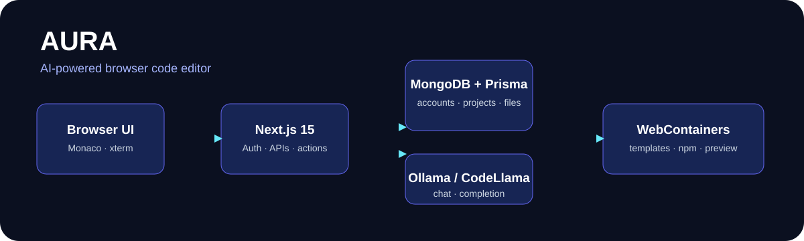
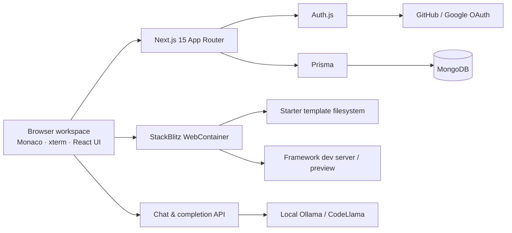
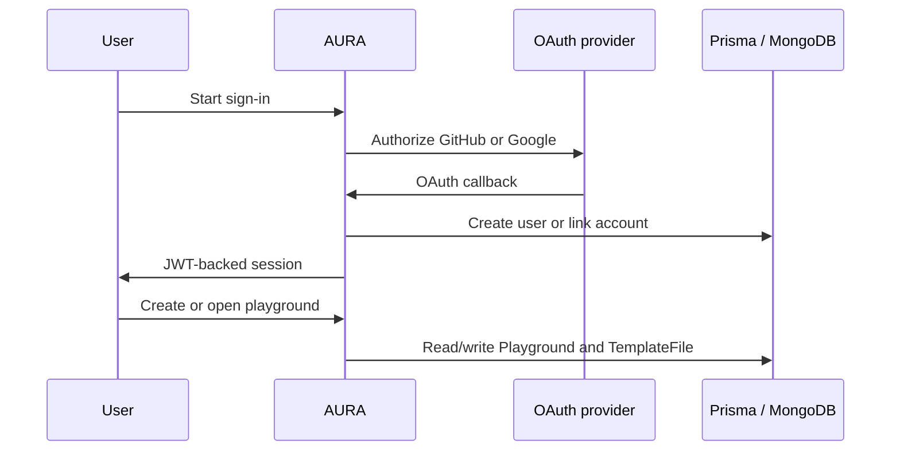
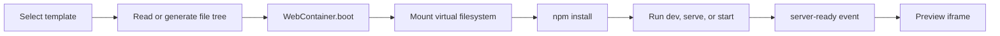

<p align="center"></p>

<p align="center">
  <a href="https://github.com/abirsarkar-wp/AURA-AI-Powered-Browser-Code-Editor"></a>
  
  
  
</p>

# AURA

### AI-Powered Browser Code Editor

Code, run, preview, and manage multi-framework projects from a browser workspace. AURA combines a Next.js application, Auth.js authentication, MongoDB persistence, Monaco, xterm.js, and StackBlitz WebContainers. The checked-in starters initialize React, Next.js, Express, Vue, Hono, and Angular playgrounds.

> Status: editor, templates, persistence, and WebContainer workflow are implemented. AI chat and completion depend on local Ollama/CodeLlama and need target-environment verification before production use.

## Contents

- [Capabilities](#capabilities)
- [Architecture](#architecture)
- [Framework templates](#framework-templates)
- [Quick start](#quick-start)
- [Environment](#environment)
- [How it works](#how-it-works)
- [API inventory](#api-inventory)
- [Documentation](#documentation)

## Capabilities

| Area | Implementation | Status |
| --- | --- | --- |
| Browser IDE | Monaco editor, multi-file tabs, explorer, create/rename/delete, Ctrl+S and save-all | Implemented |
| Project workspace | Per-user dashboard, create/edit/delete/duplicate and star playgrounds | Implemented |
| Live runtime | WebContainer mount, `npm install`, terminal output, dev-server preview | Implemented |
| Templates | React TS, Next.js, Express, Vue, Hono, Angular starters in the repository | Implemented |
| Identity | GitHub and Google OAuth via Auth.js + Prisma Adapter | Implemented |
| Persistence | MongoDB projects and serialized template-file tree | Implemented |
| AI chat | Local Ollama CodeLlama request with client-side history | Environment-dependent |
| Inline suggestions | Active-file context sent to a CodeLlama route | Implemented; runtime validation needed |

## Architecture



The browser loads a playground's persisted file tree or asks `GET /api/template/[id]` to serialize a selected starter. It mounts that tree in a WebContainer, installs dependencies, then selects `dev`, `serve`, or `start` from the template `package.json`. The `server-ready` event supplies the iframe preview URL. Read [Architecture](docs/ARCHITECTURE.md) and [WebContainers](docs/WEBCONTAINERS.md) for the execution flow.

## Framework templates

| Framework | Starter directory | Language | Preview command |
| --- | --- | --- | --- |
| React + TypeScript | `vibecode-starters/react-ts` | TypeScript | `npm run start` |
| Next.js | `vibecode-starters/nextjs-new` | TypeScript | `npm run dev` |
| Express.js | `vibecode-starters/express-simple` | JavaScript | `npm run start` |
| Vue | `vibecode-starters/vue` | JavaScript / Vue | `npm run serve` |
| Hono | `vibecode-starters/hono-nodejs-starter` | TypeScript | `npm run dev` |
| Angular | `vibecode-starters/angular` | TypeScript | `npm run start` |

The preview component checks scripts in this order: `dev`, `serve`, then `start`. These starters are required source assets; do not exclude them from deployments.

## Quick start

### Prerequisites

Node.js compatible with the checked-in lockfile, npm, MongoDB, and OAuth apps are required. For AI functionality, run Ollama with `codellama:latest`.

```bash
git clone https://github.com/abirsarkar-wp/AURA-AI-Powered-Browser-Code-Editor.git
cd AURA-AI-Powered-Browser-Code-Editor
npm ci
copy .env.example .env
npx prisma generate
npx prisma db push
npm run dev
```

Open `http://localhost:3000`. Local OAuth callbacks:

```text
http://localhost:3000/api/auth/callback/github
http://localhost:3000/api/auth/callback/google
```

Use the equivalent HTTPS base URL for a deployment.

## Environment

Copy [`.env.example`](.env.example); it contains placeholders only.

| Variable | Required for | Notes |
| --- | --- | --- |
| `DATABASE_URL` | Prisma/MongoDB | MongoDB connection string. |
| `AUTH_SECRET` | Auth.js | Generate a unique long random value. |
| `AUTH_GITHUB_ID`, `AUTH_GITHUB_SECRET` | GitHub OAuth | OAuth app credentials. |
| `AUTH_GOOGLE_ID`, `AUTH_GOOGLE_SECRET` | Google OAuth | OAuth client credentials. |

Never commit `.env` files, credentials, access tokens, or database URLs. `.gitignore` permits only `.env.example`.

## How it works

### Authentication and persistence



`auth.ts` uses the Prisma Adapter to create or link `User` and `Account` records. Middleware protects non-auth routes. A playground's latest file tree is persisted as JSON in a one-to-one `TemplateFile` record. See [Database design](docs/DATABASE.md).

### WebContainer lifecycle



Saving an editor file updates the tree, persists it, and writes it into the active WebContainer filesystem. The terminal is xterm.js connected to the same container.

### AI paths

`POST /api/chat` accepts a message and browser-held history. `POST /api/code-completion` accepts active-file content, cursor position, and filename; it extracts a context window and returns insertion text. Both make non-streaming calls to local Ollama CodeLlama. The `ChatMessage` Prisma model is not currently written by the chat UI/route. Details: [AI integration](docs/AI_INTEGRATION.md).

## API inventory

| Method | Route | Purpose |
| --- | --- | --- |
| `GET`, `POST` | `/api/auth/[...nextauth]` | Auth.js OAuth handlers. |
| `GET` | `/api/template/[id]` | Returns a selected playground starter's serializable file tree. |
| `POST` | `/api/chat` | Accepts `{ message, history }`; returns `{ response, timestamp }`. |
| `POST` | `/api/code-completion` | Accepts file/cursor metadata; returns a suggestion and context metadata. |

Server actions under `modules/dashboard/actions/index.ts` handle dashboard CRUD and starring. `modules/playground/actions/index.ts` loads a project and upserts the file tree.

## Project structure

```text
app/                         App Router pages and API routes
components/                  Shared UI and providers
modules/auth/                Session helpers and auth components
modules/dashboard/           Project dashboard and server actions
modules/playground/          Editor, explorer, persistence, file-tree tools
modules/webcontainers/       Browser runtime, terminal, live preview
modules/ai-chat/             Chat interface
prisma/schema.prisma         MongoDB data model
vibecode-starters/           Six required project starter templates
docs/                        Architecture and operational documentation
```

## Documentation

- [Architecture](docs/ARCHITECTURE.md)
- [Authentication](docs/AUTHENTICATION.md)
- [Database design](docs/DATABASE.md)
- [WebContainers](docs/WEBCONTAINERS.md)
- [AI integration](docs/AI_INTEGRATION.md)
- [Development](docs/DEVELOPMENT.md)
- [Troubleshooting](docs/TROUBLESHOOTING.md)

No verified screenshots are in this snapshot. Add real login, dashboard, playground, terminal, preview, and AI-chat captures under `docs/assets/screenshots/` from a configured environment.

## Contributing and security

Use `npm ci`, preserve the lockfile and starter folders, and do not commit generated output or secrets. Validate relevant build/type/Prisma checks before a pull request. This repository does not currently declare a project license; do not imply one without an explicit license file. StackBlitz WebContainers are used for browser execution; retain existing attribution files in `vibecode-starters/` when changing templates.
