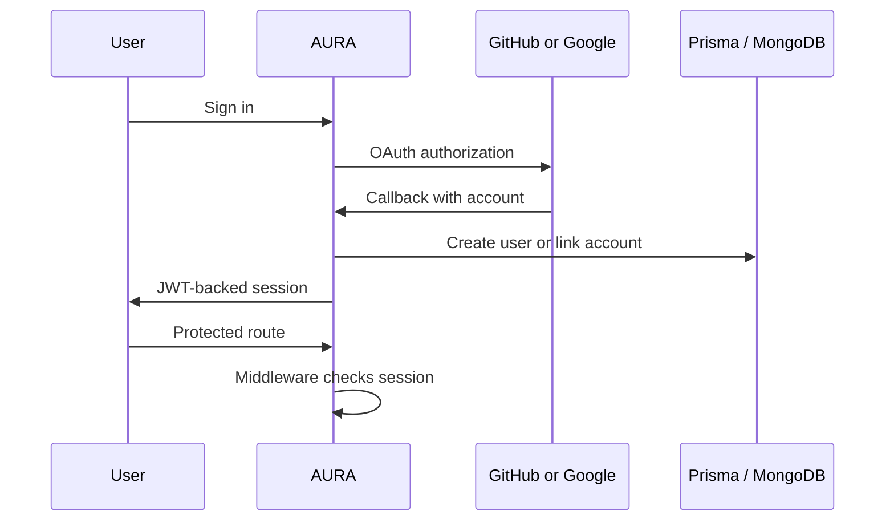

# Authentication

Auth.js is configured in `auth.ts` and `auth.config.ts` with GitHub and Google OAuth providers. The Prisma adapter persists user/account records, while the active session strategy is JWT. `middleware.ts` redirects unauthenticated requests to `/auth/sign-in` and lets `/api/auth/*` pass through.

Set the OAuth callback URLs to `http://localhost:3000/api/auth/callback/github` and `http://localhost:3000/api/auth/callback/google` for local development. Use the corresponding deployed base URL in production. Required variables are documented in the root `.env.example`.
