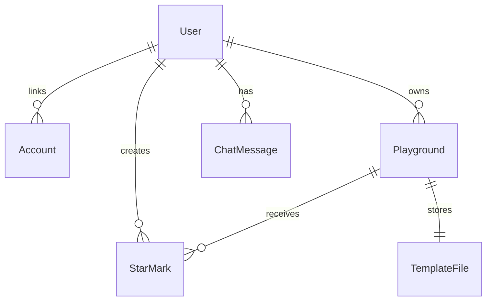

# Database design

Prisma is configured for MongoDB in `prisma/schema.prisma`; `lib/db.ts` maintains one reusable client during development.

| Model | Purpose | Relationships / constraints |
| --- | --- | --- |
| `User` | OAuth identity and role | Unique `email`; owns playgrounds, stars, accounts, and chat messages. |
| `Account` | Auth provider account | Cascades with user; unique `[provider, providerAccountId]`; indexed `userId`. |
| `Playground` | User project metadata and selected template | Cascades with user; owns star records and one optional template-file record. |
| `StarMark` | Per-user favourite flag | Unique `[userId, playgroundId]`; cascades with user and playground. |
| `TemplateFile` | Serialized project file tree | `content` is JSON; unique `playgroundId`, making this a one-to-one persisted snapshot. |
| `ChatMessage` | Reserved chat-history model | Cascades with user; indexed `userId`. The current chat route/UI does not write this model. |

The enums are `UserRole` (`ADMIN`, `USER`, `PREMIUM_USER`) and `Templates` (`REACT`, `NEXTJS`, `EXPRESS`, `VUE`, `HONO`, `ANGULAR`).
