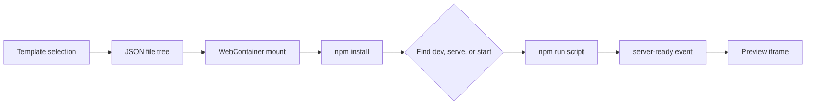

# WebContainers

`useWebContainer` (`modules/webcontainers/hooks/useWebContainer.ts`) boots the StackBlitz browser runtime and exposes filesystem writes. `WebContainerPreview` performs the setup pipeline below; `terminal.tsx` supplies an xterm.js terminal and spawns user-entered commands in the same runtime.

The editor writes saved file content to both the persisted file tree and WebContainer filesystem. A running framework's hot-reload behaviour is provided by that framework's dev server. A container is torn down by the hook when appropriate; browser support and cross-origin isolation matter, hence the COOP/COEP headers in `next.config.ts`.

There is no universal process manager beyond WebContainer process handles and teardown. If a template lacks `dev`, `serve`, and `start`, the preview intentionally reports an unsupported startup-script error.
